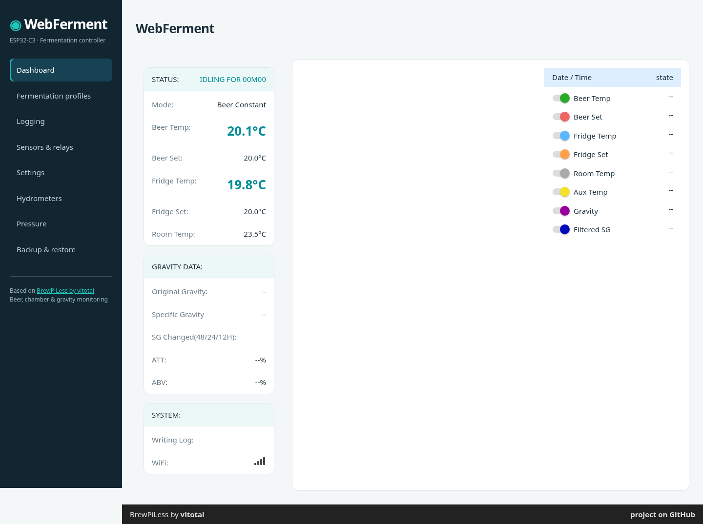
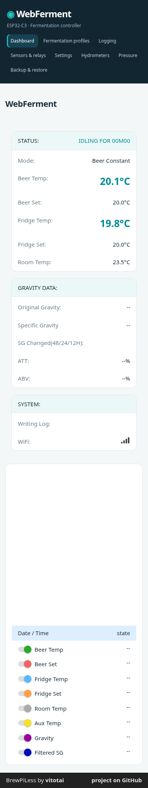

# WebFerment

An ESP32-C3 Arduino fermentation controller based on **[BrewPiLess by vitotai](https://github.com/vitotai/BrewPiLess)**, with a responsive WebBrew-inspired interface. The upstream BrewPi control algorithm, temperature profiles, sensor discovery, logging, and hydrometer integrations are retained. This is an initial derivative, not yet a hardware-validated release.

## UI mockup

Desktop dashboard rendered from the current interface with simulated temperature readings. No history is loaded in this mockup, so the chart is empty.



<details>
<summary>Mobile layout</summary>



</details>

## Arduino project

Open `WebFerment/WebFerment.ino` in Arduino IDE 2. Install **esp32 by Espressif Systems 2.0.17** using Boards Manager. Add this board index URL in Preferences:

`https://espressif.github.io/arduino-esp32/package_esp32_index.json`

Select **ESP32C3 Dev Module**, 4 MB flash, and **Minimal SPIFFS (1.9 MB APP with OTA)**. The sketch's `partitions.csv` supplies the upstream dual-slot layout. Confirm your specific C3 module has 4 MB flash. Display, encoder, buzzer, humidity and pressure support are disabled for C3 in `WebFerment/src/Config.h`. AsyncTCP defaults to any available core, supporting the C3's single core.

Install ArduinoJson **6.19.3** and NimBLE-Arduino **2.2.3**. Use the AsyncTCP and ESPAsyncWebServer revisions listed in `scripts/install_arduino.sh`, plus the bundled libraries from `lib` and `lib-esp32`, in your Arduino sketchbook `libraries` folder. The cloud installer prepares that standard layout automatically.

For Arduino CLI in the cloud machine:

```sh
cd /workspace/webferment
bash scripts/install_arduino.sh
bash scripts/build_arduino.sh
```

The installer pins Arduino CLI 1.2.2, verifies its official SHA256 checksum, prepares the libraries, and installs Arduino ESP32 core 2.0.17. Both Arduino IDE and Arduino CLI use the same sketch. There is no PlatformIO build configuration.

## Wiring and first boot

| Function | C3 GPIO |
| --- | --- |
| Shared OneWire temperature probe bus | 4 |
| Available actuator outputs | 5, 6, 7, 10, 3 |
| Reserved I2C SDA / SCL | 0 / 1 |

These are proposed defaults, not a verified wiring diagram for your board. GPIO numbers are chip GPIO numbers. Do not use GPIO12–17 (flash), GPIO18/19 (USB), or GPIO2/8/9 (strapping) for the proposed outputs. Assign beer/chamber DS18B20 probes and heating/cooling outputs in **Sensors & relays**. Use the probe manufacturer's pull-up requirements (typically 4.7 kΩ to 3.3 V for DS18B20), and verify relay polarity with loads disconnected. Retained settings from other boards must be cleared or reassigned before connecting loads. Compressor delays and sensor fault handling remain upstream BrewPiLess; validate them on your hardware before unattended use.

With the device connected to a development computer:

```sh
/workspace/bin/arduino-cli --config-file scripts/arduino-cli.yaml upload \
  --fqbn esp32:esp32:esp32c3 --port <serial-port> --input-dir build WebFerment
/workspace/bin/arduino-cli --config-file scripts/arduino-cli.yaml monitor \
  --port <serial-port> --config baudrate=115200
```

Follow the upstream WiFi provisioning workflow. The default network hostname is `webferment`. The inherited default web credentials are `brewpiless` / `brewpiless`; change them in Settings and keep the controller on a trusted local network. Web assets are embedded in firmware; a separate filesystem upload is not needed for the interface. OTA support and the upstream dual-slot partition table are retained, but not yet validated on C3.

## Interface development

Edit `web/theme.css`. `web/upstream` contains the original release's bundled English pages, including its existing JavaScript and protocol. `python scripts/build_web.py` injects the new navigation/style and regenerates the compressed headers in `WebFerment/src`. The Arduino CLI build script runs this automatically; run it before compiling in Arduino IDE after interface edits. This deterministic Python build avoids the upstream legacy Grunt/Ruby dependency chain. Other language assets remain upstream.

Optional browser verification in the prepared cloud machine:

```sh
python scripts/build_web.py
node scripts/check_web.cjs
```

The browser test uses Playwright with system Chromium and simulated BrewPiLess WebSocket messages. It verifies beer/chamber temperatures and targets, navigation, desktop/mobile layout, and browser script errors. It does not establish physical sensor, relay, BLE, profile execution, or OTA behavior.

## Validation status

- Passed: deterministic embedded frontend generation; browser dashboard smoke test at 1440px and 390px with simulated device messages.
- Blocked: firmware compilation, because the cloud network proxy denies Arduino board indexes. Required domains: `downloads.arduino.cc` and `espressif.github.io`. Further download hosts may be identified after access is enabled.
- Unrun: flashing and hardware integration, because no ESP32-C3 is attached.

## Credits and licence

BrewPiLess is authored by vitotai and builds on BrewPi by Elco Jacobs and Matthew McGowan, along with the contributors named in the retained source notices. See [UPSTREAM.md](UPSTREAM.md) for the exact imported revision. GPL-3.0-or-later notices in the BrewPi controller are preserved; [COPYING](COPYING) supplies the GPL v3 text. Bundled libraries retain their own licences. The visible interface links to BrewPiLess by vitotai. WebBrew supplied the visual direction.
